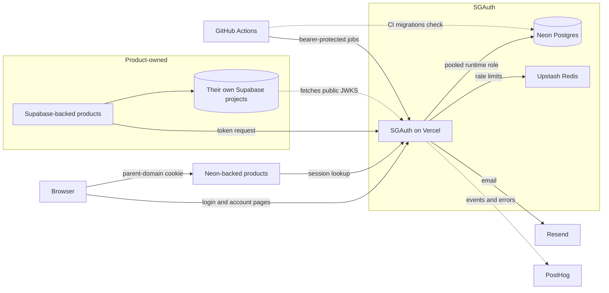
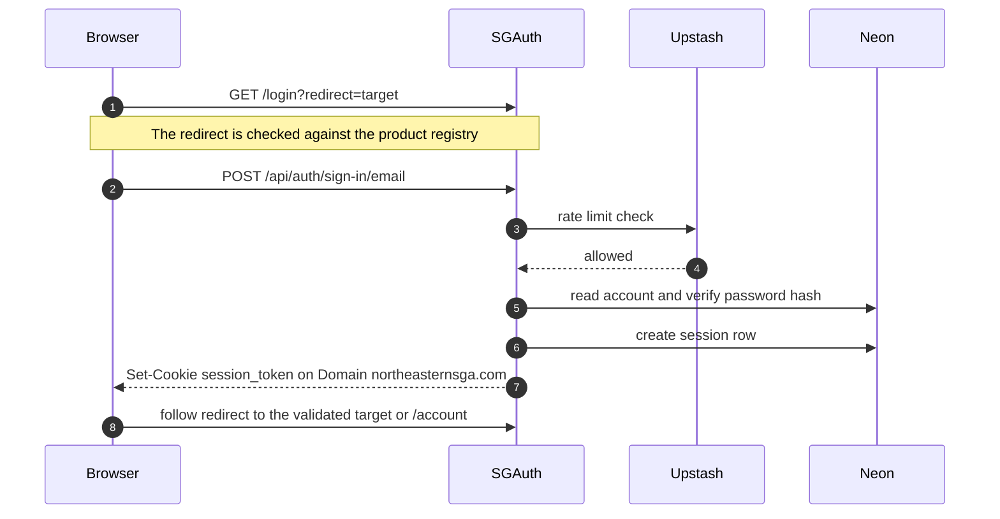
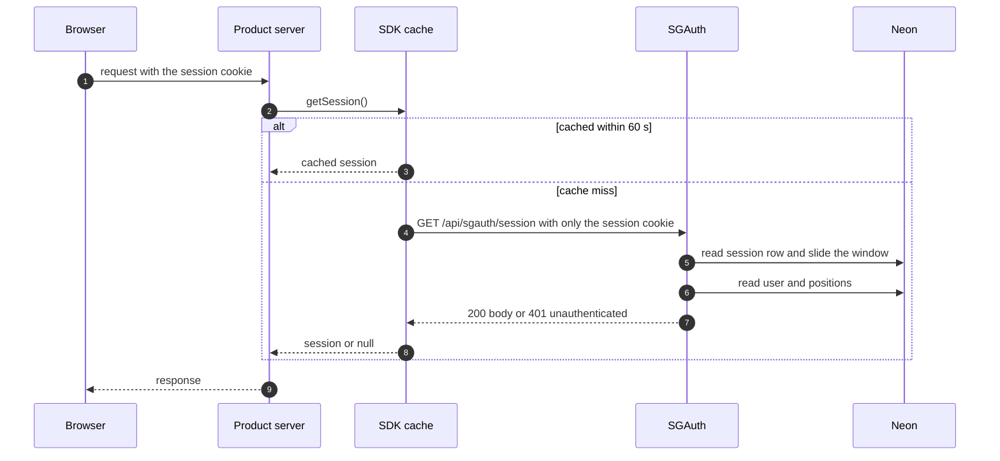
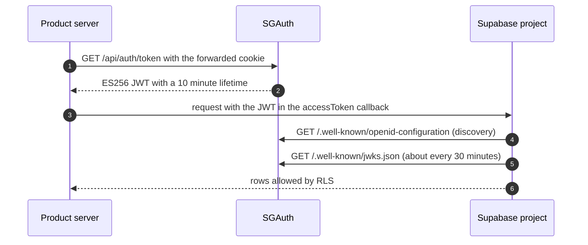
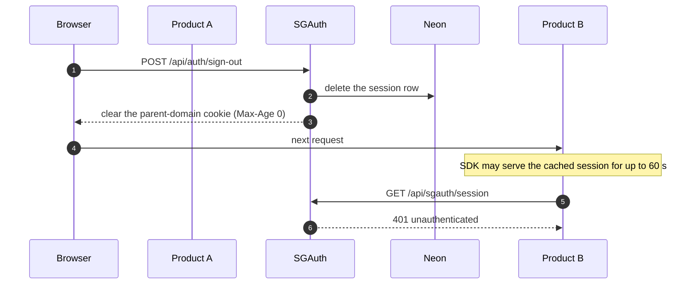
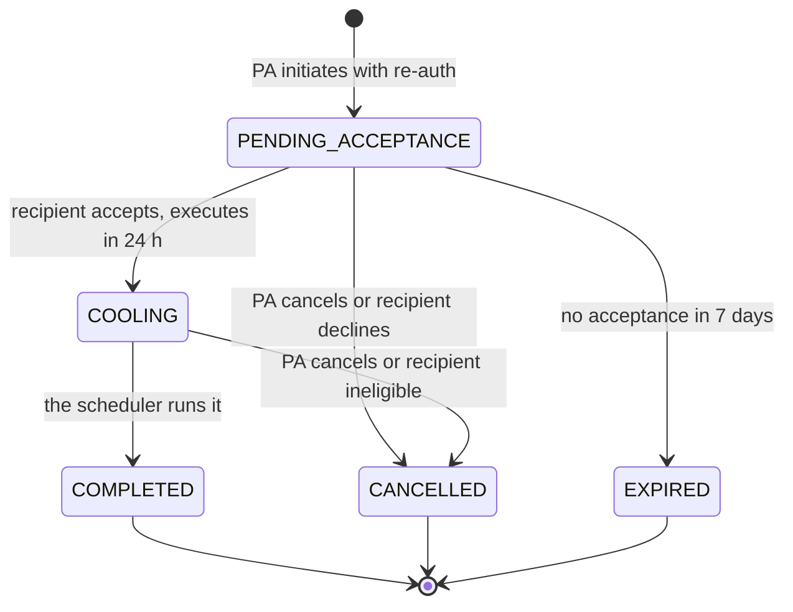
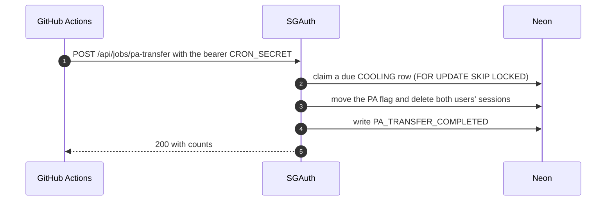
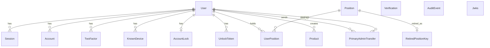
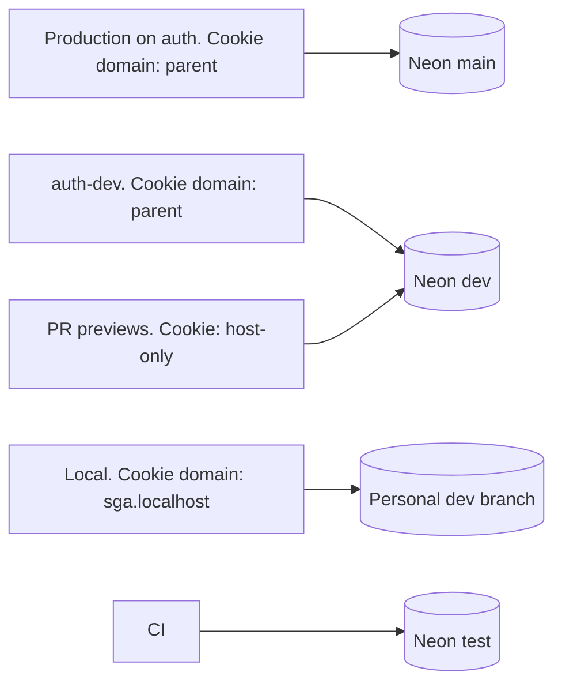

# Architecture

SGAuth runs on Neon serverless Postgres and does not use Supabase for any
purpose.

A user signs in once at `auth.northeasternsga.com`, and one session is shared by
every product on `*.northeasternsga.com` through a parent-domain cookie. SGAuth
is the only credential store, and products key their data on the SGAuth user id
(UUID v7). This document is the map: it shows how the pieces fit and links to the
documents that hold each contract, without copying them. Parts that are not
built yet are tagged _(planned, #N)_ with the ticket that builds them, and the
tag is dropped when that ticket lands.

## Components

| Component                                       | Role                                                                                                                                                                                                                                           | Configured or documented in                                                                        |
| ----------------------------------------------- | ---------------------------------------------------------------------------------------------------------------------------------------------------------------------------------------------------------------------------------------------- | -------------------------------------------------------------------------------------------------- |
| Browser                                         | Signs in at SGAuth and carries the session cookie to every product.                                                                                                                                                                            | [SESSION-COOKIE.md](SESSION-COOKIE.md)                                                             |
| SGAuth on Vercel                                | Next.js 16 on the Node runtime, region `iad1`. Better Auth is mounted at `/api/auth/[...all]`. `src/proxy.ts` runs the preview gate and the CSP. The product endpoints live under `/api/sgauth/*`.                                             | [ENVIRONMENTS.md](ENVIRONMENTS.md), [SESSION-ENDPOINT.md](SESSION-ENDPOINT.md), [CORS.md](CORS.md) |
| Neon Postgres                                   | Project `sgauth`, `aws-us-east-1`. The app uses the pooled `runtime` role (`DATABASE_URL`). `prisma migrate deploy` runs in the Vercel build over the direct `migration` role (`DIRECT_URL`).                                                  | [ENVIRONMENTS.md](ENVIRONMENTS.md), [MIGRATIONS.md](MIGRATIONS.md)                                 |
| Upstash Redis                                   | Rate limits. Every limit fails open with an alert line in the logs. The session endpoint never calls it.                                                                                                                                       | [RATE-LIMITING.md](RATE-LIMITING.md)                                                               |
| Resend                                          | Sends email from `auth.northeasternsga.com` through SGAuth's own Resend account. The infrastructure and templates exist, and each flow wires in its own email.                                                                                 | [EMAIL.md](EMAIL.md)                                                                               |
| PostHog                                         | Funnel events with no PII, plus error tracking _(planned, SGAOperations/auth#87)_.                                                                                                                                                             | not built yet                                                                                      |
| GitHub Actions                                  | CI, the Neon quota monitor, branch hygiene, and the scheduled jobs that call the bearer-protected `/api/jobs/*` routes. There is no Vercel cron.                                                                                               | [CONTRIBUTING.md](../CONTRIBUTING.md), [ENVIRONMENTS.md](ENVIRONMENTS.md#scheduled-jobs)           |
| Neon-backed products                            | Read the shared cookie and call the session endpoint through the SDK `@nusgaops/sgauth`. The package and `getSession()` exist. The Next.js helpers and `getAccessToken()` are _(planned, SGAOperations/auth-sdk#4, SGAOperations/auth-sdk#5)_. | [SESSION-ENDPOINT.md](SESSION-ENDPOINT.md)                                                         |
| Supabase-backed products and their own projects | Outside SGAuth's boundary. They are product-owned.                                                                                                                                                                                             | the Supabase product guide _(planned, SGAOperations/auth#93)_                                      |

SGAuth has no Supabase dependency. A Supabase-backed product's project fetches
SGAuth's public JWKS, and SGAuth never calls it. The one exception is the manual
`custom_jwks` push during key rotation, which an operator runs from a script
_(planned, SGAOperations/auth#81)_. The rotation tool itself is
`npm run jwks:rotate`.

## Request flows

### Login

Sign-in is built at the Better Auth endpoint. The login page and the validated
redirect are not _(planned, SGAOperations/auth#37, SGAOperations/auth#43)_.

- The redirect is validated against the product registry (`src/lib/products.ts`)
  and kept in a short-lived signed cookie _(planned, SGAOperations/auth#43)_. The
  registry itself is built.
- `POST /api/auth/sign-in/email` goes through the Upstash limiter
  (`withAuthRateLimit`). If it is not limited, Better Auth checks the account
  lockout _(planned, SGAOperations/auth#76)_ and the password hash. Imported
  `bcrypt$` hashes are re-hashed to scrypt on first login.
- `session.create.before` refuses users who are not `ACTIVE` and clamps
  `expiresAt` to `absoluteExpiresAt`.
- The cookie is `__Secure-sgauth.session_token` on `Domain=northeasternsga.com`.
  Other environments use other names: see [SESSION-COOKIE.md](SESSION-COOKIE.md).
- Responses are enumeration-resistant _(hardening: planned,
  SGAOperations/auth#82)_. Email verification is required, and there is no auto
  sign-in. The verification email itself is not wired yet _(planned,
  SGAOperations/auth#30)_.
- The 30-day sliding window, the 90-day cap and the reason there is no cookie
  cache are in [SESSION-COOKIE.md](SESSION-COOKIE.md#session-lifetime). Imported
  password-less accounts will get a set-password link instead _(planned,
  SGAOperations/auth#34)_.

### Product session lookup

- On every request the product's `proxy.ts` checks only that the cookie is
  present, with no network call, and redirects to `loginUrl` when it is missing.
  That helper is part of the SDK _(planned, SGAOperations/auth-sdk#4)_.
- The answer is a `200` with the contract body, or a uniform `401` with
  `{"error":"unauthenticated"}` that never says why.
- Every response carries `Cache-Control: no-store` and `Vary: Cookie`.
- The endpoint makes no Redis call. It has only an in-process per-token bucket
  (`session-lookup:session:1m`).
- Stale-if-error: on a `5xx` or a timeout the SDK serves its cached entry for up
  to 5 minutes, and with no cached entry it fails closed.
- `/api/sgauth/session/minimal` is for hot paths. The full contract is in
  [SESSION-ENDPOINT.md](SESSION-ENDPOINT.md), and browser calls are in
  [CORS.md](CORS.md).

### Supabase token flow

- The product server calls `getAccessToken()` in the SDK _(planned,
  SGAOperations/auth-sdk#5)_. The `/api/auth/token` endpoint is built, and the
  `token:session:1m` limit applies to it.
- The Better Auth `jwt` plugin signs an ES256 token with a `kid` header and a
  10-minute lifetime. Claims: `iss` is the environment's base URL (production
  `https://auth.northeasternsga.com`), `aud` is `authenticated`, `sub` is the
  user UUID, `role` is `authenticated`, plus `email`, `name`, `positions`,
  `is_admin` and `is_primary_admin`.
- RLS uses `auth.uid()` and `auth.jwt() -> 'positions'`. Third-party users have no
  `auth.users` row.
- Position and revocation changes reach Supabase within 10 minutes at most.
- JWKS rotation is manual, with a 7-day overlap, because automatic rotation would
  reject fresh tokens until Supabase re-fetches the JWKS. The operator runbook
  is _(planned, SGAOperations/auth#81)_.
- The integration guide is _(planned, SGAOperations/auth#93)_.

### Logout propagation

Sign-out is built at Better Auth's `/api/auth/sign-out`. `GET /logout`,
`POST /api/sgauth/sessions/revoke-all`, the own-sessions list and revoke routes
(`GET /api/sgauth/sessions`, `DELETE /api/sgauth/sessions/[id]`) and
`revokeAllSessionsForUser()` are built too. Only the admin users endpoint that
calls the revocation function is not _(planned, SGAOperations/auth#48)_. The
contract is in [LOGOUT.md](LOGOUT.md).

Staleness bounds after a sign-out or a revocation:

| Path                     | Bound                |
| ------------------------ | -------------------- |
| SGAuth's own pages       | the next request     |
| Neon product via the SDK | 60 s at most (cache) |
| Supabase product         | 10 min at most (JWT) |

The design summary says logout is "immediate for Neon products". That holds at
SGAuth, and the SDK cache adds up to 60 seconds on top.

- `/logout?redirect=` rejects `Sec-Fetch-Site: cross-site` and validates the
  redirect against the registry.
- Sign-out everywhere, admin revocation, deactivation and "force re-login" all
  delete session rows, so they behave the same. The admin endpoint that
  triggers revocation is _(planned, SGAOperations/auth#48)_.
- Deactivation is also caught by the `/get-session` after-hook in
  `src/lib/auth/options.ts`, and by the `/token` payload check.
- The clearing `Set-Cookie` uses the same Domain, Path and prefix as the cookie
  it removes, which is why the contract fixes them in one place.

### Primary Admin transfer

Execution and expiry are built. Initiating, accepting and cancelling are not
_(planned, SGAOperations/auth#49, SGAOperations/auth#44)_.

- The job runs hourly, at minute 7, against production. The schedule and the
  reason it is not every 15 minutes are in
  [ENVIRONMENTS.md](ENVIRONMENTS.md#scheduled-jobs).
- One transaction moves the PA flag, keeps both users as admins, and revokes both
  users' sessions. If the recipient is no longer an active admin, or the sender
  is no longer the PA, the transfer is cancelled instead.
- There is exactly one PA, enforced by a partial unique index and triggers, and
  exactly one in-flight transfer, enforced by a partial index.
- The notification emails to both users and every admin are not wired yet, so
  the job only logs them _(planned, SGAOperations/auth#49)_.
- Break-glass recovery is an offline script with no HTTP path:
  [runbooks/break-glass.md](runbooks/break-glass.md).
- Every step writes an `AuditEvent`.

## Data model

Relationships only. `prisma/schema.prisma` is the source of truth for attributes.

Invariants enforced in Postgres, each in the named migration directory:

- UUID v7 ids come from Prisma (`@default(uuid(7))`), and the email column is
  `citext` (`core_identity_schema`).
- A single Primary Admin, and one in-flight transfer
  (`primary_admin_invariants`).
- `AuditEvent` is append-only (`audit_event`).
- `Position.key` is unique among active rows (`positions`).
- The session absolute-cap clamp trigger (`session_absolute_cap`).
- Users are never hard-deleted: they are deactivated, or tombstoned with status
  `DELETED`. The tombstone job is _(planned, SGAOperations/auth#90)_.

Better Auth owns Session, Account, Verification, TwoFactor and Jwks. SGAuth's own
code owns the rest.

## Environment topology

- PR previews cannot use product SSO, because the browser never sends a
  `northeasternsga.com` cookie to `vercel.app`.
- PR migrations must be expand-only, because `auth-dev` and every preview share
  the Neon `dev` database.
- There is no Neon-Vercel integration, so a PR never creates a Neon branch.

URLs, cookie names and variables are in [ENVIRONMENTS.md](ENVIRONMENTS.md).

## Related documents

| Document                                                                         | What it covers                                      | Status                            |
| -------------------------------------------------------------------------------- | --------------------------------------------------- | --------------------------------- |
| [ENGINEERING.md](ENGINEERING.md)                                                 | The quality bar and the pre-pull-request checklist  | linked                            |
| [sgauth-design/SGAuth-design-summary.md](sgauth-design/SGAuth-design-summary.md) | The settled architecture                            | linked                            |
| [sgauth-design/SGAuth-red-team.md](sgauth-design/SGAuth-red-team.md)             | The threat review                                   | linked                            |
| [ENVIRONMENTS.md](ENVIRONMENTS.md)                                               | Environments, variables, cookies, jobs and gates    | linked                            |
| [SESSION-COOKIE.md](SESSION-COOKIE.md)                                           | The cookie contract and session lifetime            | linked                            |
| [SESSION-ENDPOINT.md](SESSION-ENDPOINT.md)                                       | The product session endpoint contract               | linked                            |
| [RATE-LIMITING.md](RATE-LIMITING.md)                                             | Limits, and what happens when Upstash is down       | linked                            |
| [EMAIL.md](EMAIL.md)                                                             | The Resend account, DNS, keys and templates         | linked                            |
| [CORS.md](CORS.md)                                                               | Browser calls from registered products              | linked                            |
| [LOGOUT.md](LOGOUT.md)                                                           | Logout and session revocation contract              | linked                            |
| [ROLLOUT.md](ROLLOUT.md)                                                         | The rollout plan and user communications            | linked                            |
| [MIGRATIONS.md](MIGRATIONS.md)                                                   | Where each schema command may run                   | linked                            |
| [CONTRIBUTING.md](../CONTRIBUTING.md)                                            | CI checks and branch protection                     | linked                            |
| [runbooks/neon-restore.md](runbooks/neon-restore.md)                             | Restoring Neon data                                 | linked                            |
| [runbooks/neon-upgrade.md](runbooks/neon-upgrade.md)                             | Moving to the Launch plan                           | linked                            |
| [runbooks/on-call.md](runbooks/on-call.md)                                       | Notes for whoever is watching SGAuth                | linked                            |
| [runbooks/positions-sync.md](runbooks/positions-sync.md)                         | Syncing the curated position list                   | linked                            |
| [runbooks/break-glass.md](runbooks/break-glass.md)                               | Primary Admin recovery                              | linked                            |
| [runbooks/launch-checklist.md](runbooks/launch-checklist.md)                     | Launch checklist and Primary Admin bootstrap        | linked                            |
| [runbooks/subdomain-review.md](runbooks/subdomain-review.md)                     | Inventorying and cleaning `northeasternsga.com` DNS | linked                            |
| [runbooks/legacy-bcrypt.md](runbooks/legacy-bcrypt.md)                           | Tracking imported bcrypt hashes                     | linked                            |
| Neon product guide                                                               | Integrating a Neon-backed product                   | planned, SGAOperations/auth#92    |
| Supabase product guide                                                           | Integrating a Supabase-backed product               | planned, SGAOperations/auth#93    |
| Admin runbooks                                                                   | Day-to-day admin tasks                              | planned, SGAOperations/auth#94    |
| `runbooks/rotate-secrets.md`                                                     | Secret and JWKS rotation                            | planned, SGAOperations/auth#81    |
| `DATA_HANDLING.md`                                                               | The privacy notice and data handling                | planned, SGAOperations/auth#95    |
| SDK README                                                                       | Using `@nusgaops/sgauth`                            | planned, SGAOperations/auth-sdk#6 |

## Known limitations

### Neon Free plan quota

SGAuth launches on the Neon **Free** plan, which allows **100 CU-hours of
compute per month** per project. Past that, Neon suspends the compute until the
monthly period resets, and every SGA product's login goes down at once. A
compute that stays awake all day at the 0.25 CU minimum uses about 180
CU-hours a month, so exhaustion is plausible once several products are live.

Mitigations:

- A daily job (`.github/workflows/neon-quota-monitor.yml`) emails alerts at
  50%, 70%, 85% and 100% of the quota, with a projected exhaustion date.
- Scale-to-zero stays at 5 minutes, and the SDK's 60 second session cache keeps
  idle periods idle so the compute can suspend.
- No keep-warm pings, ever: they burn the quota (see `docs/ENGINEERING.md`).
- The upgrade runbook, [`runbooks/neon-upgrade.md`](runbooks/neon-upgrade.md),
  moves the project to Launch. Its trigger is 85% of the quota or any
  suspension.

### 6-hour restore window

History retention on the `main` branch is capped at **6 hours** on the Free
plan. A problem noticed after that is not recoverable from Neon itself. The
procedure and its limits are in
[`runbooks/neon-restore.md`](runbooks/neon-restore.md). The Launch plan extends
the window to 7 days.

## Security policies

- [SUBDOMAIN-POLICY.md](SUBDOMAIN-POLICY.md): who may have a
  `northeasternsga.com` subdomain, and why every one can read the session
  cookie.

## Maintaining this document

- The owner is the SGAuth lead.
- Any pull request that changes a component, a flow, an entry point or an
  invariant described here updates this file in the same pull request, and drops
  the _(planned, #N)_ tag of the ticket it completes.
- It is reviewed at each phase boundary.
